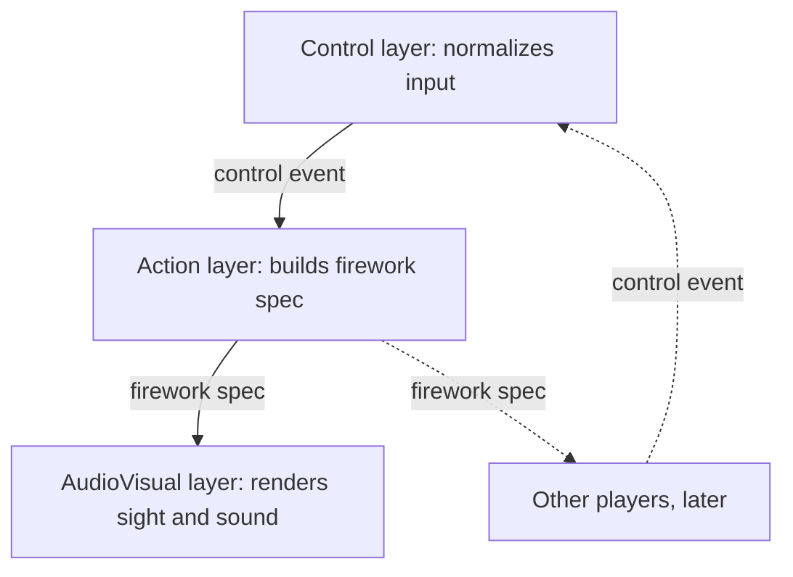

# Fireworks game — intent

## Vision

A browser-based, 2D horizontal-platform-view fireworks game, built in JavaScript with WebGL for dynamic visual effects. Built for two purposes at once: a project for the author to learn game architecture, and a game for kids to play.

## Core gameplay loop

- Press any key → one firework launches.
- Sequences (keys pressed in order) unlock special patterns.
- _(Future direction, not v1 — see "Explicitly descoped for v1" below: chords, keys pressed together, launching multiples with combined effects.)_
- Each key press seeds a random-but-repeatable set of colors, patterns, and effects.
- Sound effects follow each firework's sprite; background music's pace and density respond to how fast and how often the player is playing.

## Hypothesis

Randomness that is seeded (not pure noise) lets patterns emerge that a player can learn — like a piano, where pressing the same key family tends to feel familiar, while never being identical twice. Chords and combos let a player compose "visual music" instead of just triggering effects.

## Design philosophy: three layers

The system is split into three layers so each can be understood, tested, and swapped independently:

- **Control** — only knows about raw input (currently: a keyboard). Normalizes it into a clean signal. Never decides what a firework looks like.
- **Action** — owns the rules: chord/sequence detection state, the seeded randomness, and turning a control event into a finished firework spec. Owns no rendering or audio.
- **AudioVisual** — takes a finished firework spec and renders it. Never re-derives anything Action already decided.

Data flows one direction only, control → action → audiovisual. Nothing downstream ever reaches back upstream.

## Multiplayer (seam only, not building yet)

Multiple players should eventually see the _same_ firework on every screen. That means the firework spec — including any random seed — must be finalized once, in the Action layer, before it's handed to rendering. It is never decided by (or duplicated per) an individual player's screen. Building this is explicitly out of scope for now; the architecture just needs to not preclude it.

## Explicitly descoped for v1

- **Hold-to-charge intensity.** Originally considered: keydown starts a "charge," keyup finalizes it, hold duration maps (via a curve — likely exponential, capped around 5 seconds) to an intensity value. Descoped to keep timing simple. The control signal keeps an `intensity` field so this can be reintroduced later without a shape change — for now it's a constant.
- **Non-keyboard input** (MIDI, device motion). The adapter pattern is designed to allow this later; no other adapter is being built now.
- **Remote/networked play.** See multiplayer note above — seam reserved, not implemented.
- **Chords and key combos.** Only sequences of keys are in scope for v1 — a chord (keys pressed together within a tight window, launching a combined effect) is not built. See `02_spec.md` for why this also isn't just a scheduling detail: chord detection conflicts with instant-fire and with keeping classification a pure, replayable function.

## What "working" looks like for v1

- Any key launches a firework with seeded, varied color/pattern.
- At least one authored sequence launches a special pattern.
- The three layers are separately testable: Control's signal production is a pure function over timestamped key events; Action and AudioVisual aren't blocked on each other.
