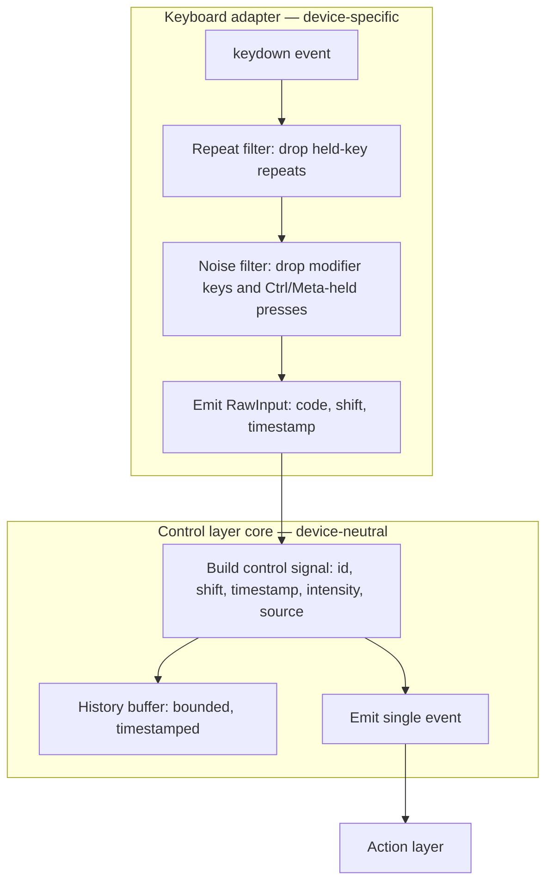
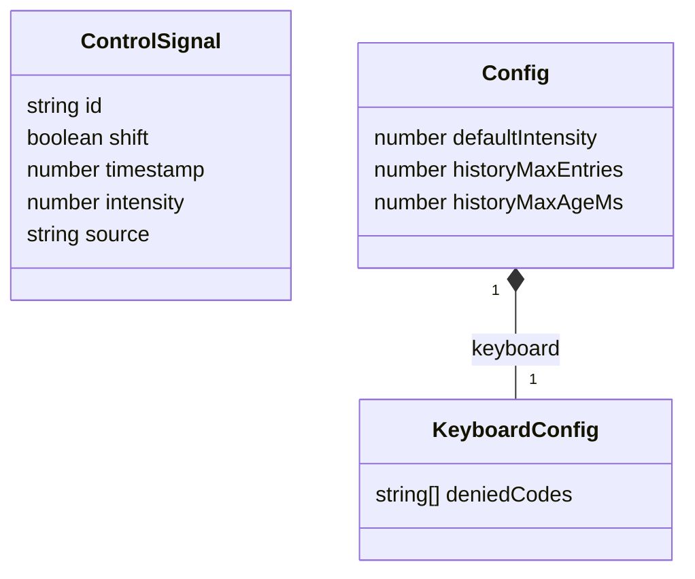
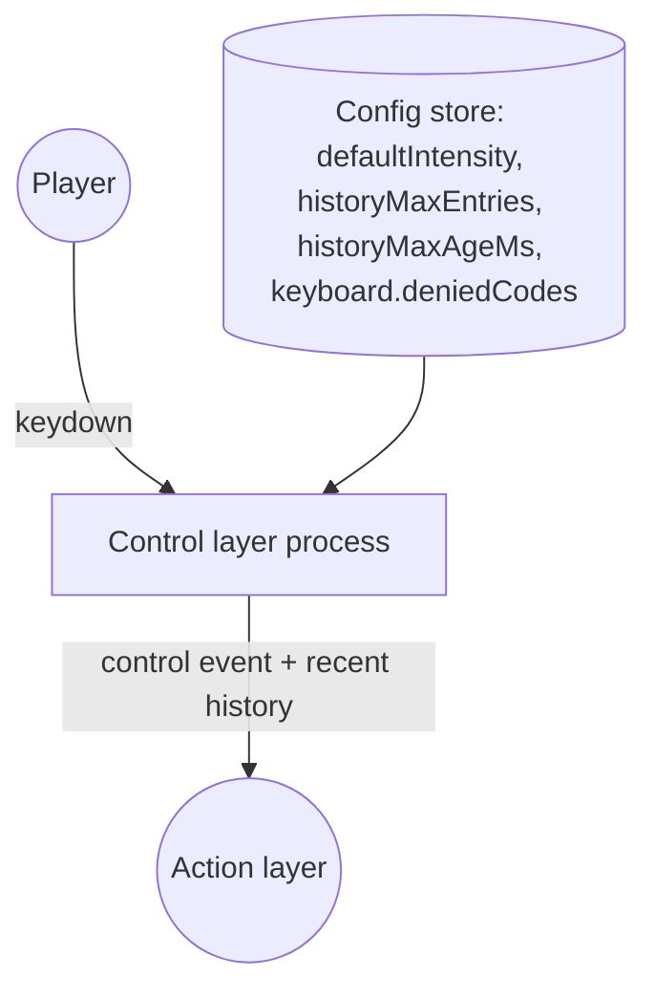
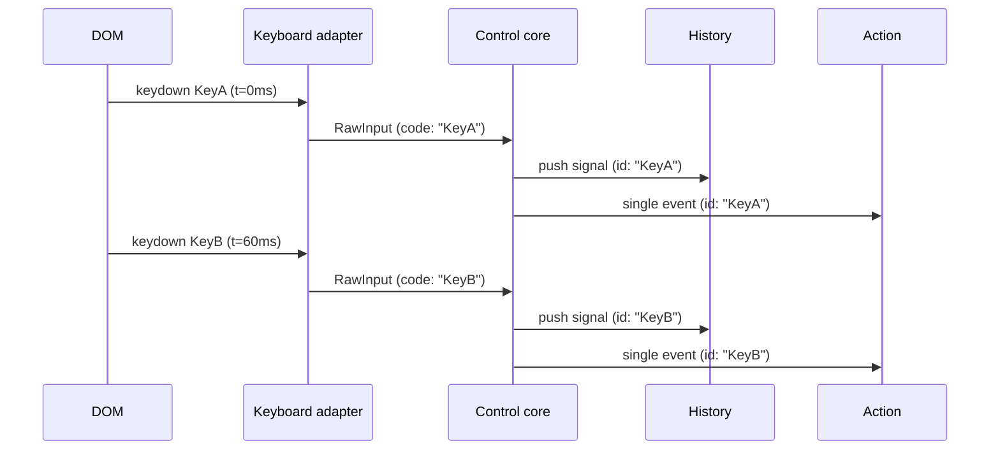

# Fireworks game — control layer spec (v1, keyboard only)

See `01_intent.md` for the overall vision and layering philosophy, and `03_plan_control_layer.md` for the build plan (file layout, contracts, and test-driven build order) that implements what this document specs. This document specs the **Control layer** only — turning keyboard input into one normalized signal handed to the Action layer. The Action and AudioVisual layers are out of scope here; in particular, **sequence interpretation is an Action-layer concern**, not Control's (see "What Control does not do" below).

## Scope for v1

- Keyboard input only (adapter pattern reserved for future MIDI/motion adapters, not built now).
- No hold-to-charge intensity — everything resolves on `keydown`, not `keyup`.
- No networking — this spec assumes a single local player.
- **No chords.** Chords (keys pressed together triggering a combined effect) are descoped for v1 — see "Why chords are out" below. Sequences (keys pressed in order) are in scope, but their _interpretation_ belongs to Action, not Control.

## Why chords are out

Chords were considered for v1 and explicitly dropped. Two independent reasons, either one sufficient on its own:

1. **They conflict with "instant fire."** The whole point of a chord is recognizing that several keys landed together — which means waiting to see if more keys arrive before deciding anything happened. That's a real design tension for a beginner to internalize coming from request/response web development: a web handler runs once a request is fully in hand; here, "is this input part of a bigger pattern?" can only be answered by _not acting yet_, for some window of time. Every key press would either need an artificial delay before it produces anything, or fire immediately as a single and then get retroactively "upgraded" to a chord — both add real complexity for a v1. Dropping chords means every `keydown` can be classified and forwarded the instant it arrives, which keeps this layer's mental model simple: no waiting, ever.
2. **They'd break determinism.** One goal of this layer (see "Extensibility notes" below) is that classification is a pure function: the same list of timestamped signals always classifies the same way, so a recorded key log can be replayed and get the same result. A chord detector that has to "wait and see" is stateful in a way that's easy to get subtly wrong — and that statefulness isn't needed for v1's actual gameplay goal (any key produces a firework; sequences unlock something special).

If chords come back later, the seam is already there: the Control→Action event shape below is a discriminated union with one member (`"single"`) today. Adding a `"chord"` member is additive — it doesn't require reshaping what already exists.

## Stack

- **TypeScript** — the control signal is a small, precise shape; typing it catches mismatches between layers early. `tsconfig.json`'s `strict` flag is on, so TypeScript proves shapes match rather than just documenting them.
- **Vite** — dev server and bundling.
- **Vitest** — unit tests. In particular, the history buffer must be tested with a fake clock (an injected clock function, not `Date.now()`), so timing-dependent behavior (buffer expiry) can be tested deterministically without real delays. This matters more in games than in typical web-app testing: a web app's tests usually wait for a promise or a fixed timeout, but here the code being tested is _about_ time (durations between key presses), so if the test also has to wait in real time, it's both slow and flaky. Injecting the clock means a test can say "pretend 3000ms just passed" instantly.
- **Raw WebGL2** for rendering (AudioVisual layer) — no rendering framework. Written by hand: buffers, shaders, draw calls. This is a deliberate choice to learn the underlying mechanics rather than have them hidden by a library.
- **Web Audio API**, no external audio libraries — sound effects and music are synthesized (oscillators, filters), not sample-based.

This choice only affects the AudioVisual layer's implementation. The Control layer spec'd below is plain TypeScript functions and objects — nothing about it depends on WebGL or Web Audio, and it should be buildable and fully unit-tested before any rendering code exists.

## Pipeline



Notes on each stage:

- **Repeat filter**: the browser fires repeated `keydown` events while a key is held. Filter these out — one physical press should produce one signal. This happens in the keyboard adapter, not the core (see "Where noise filtering belongs" below).
- **Noise filter**: a deny-list, not an allow-list (see "Why a deny-list, not an allow-list" below). It drops keydowns that are pure modifiers (`ShiftLeft`, `ShiftRight`, `ControlLeft`, `ControlRight`, `AltLeft`, `AltRight`, `MetaLeft`, `MetaRight`, `CapsLock`) and any press held together with Ctrl or Meta, so OS/browser shortcuts (Cmd+R, Ctrl+W, etc.) are never hijacked. Everything else passes through — letters, digits, punctuation, Tab, arrows, function keys, Space. This also happens in the keyboard adapter.
- **Build control signal**: assembles the five-field object below, from the adapter's device-neutral `RawInput`. `intensity` is currently always the config's `defaultIntensity` constant (hold-based charging is descoped — see `01_intent.md`). This step runs in the Control layer's core, which never sees a raw DOM event.
- **History buffer**: every signal is pushed to a single bounded, timestamped buffer. Control does not interpret this history — it only keeps it and hands the Action layer both the new signal and, on request, recent history. Interpreting the history (recognizing a sequence pattern in it) is Action's job (see below).

## Where noise filtering belongs

The repeat filter and noise filter both live in the keyboard adapter, not the Control layer's core. The
core's job is to turn "something happened" into a `ControlSignal` and remember it — it should never need
to know what `event.repeat` means, or that `"ShiftLeft"` is a modifier key. Those are keyboard facts, and
the adapter is the only piece of this system allowed to know a keyboard exists (see "Extensibility
notes" below). A future MIDI or motion adapter defines its own idea of noise — a stuck sustain pedal, a
sensor's rest-state jitter — without the core changing at all, and without inheriting a `deniedCodes`
list full of keyboard key names that would mean nothing to it.

Concretely: the adapter emits a `RawInput` — `{ code, shift, timestamp }`, a device-neutral shape with no
policy baked in — only for presses it has decided are meaningful. The core never sees a rejected press;
it has no rejection logic of its own to write or test.

## What Control does not do

This section exists because the boundary here is easy to get wrong coming from a typical web app's MVC split, where a controller often _does_ interpret input ("this is a search query," "this is a form submit").

- **Control does not decide what counts as a sequence.** It has no concept of a named pattern, no timeout logic for "did these three keys complete a pattern," and no per-pattern state. It only maintains one flat, time-ordered, size-bounded history of recent signals. The Action layer reads that history and decides whether a game-relevant pattern occurred. This split matters for testability: Control's output is verifiable with no knowledge of what any sequence means, and sequence _rules_ can change (new patterns, retuned timeouts) without touching Control at all.
- **Nothing in this system narrows the keyboard down to "the keys that matter for gameplay."** The adapter only removes noise (repeats, modifiers, OS-shortcut collisions) — see "Why a deny-list, not an allow-list" below. Deciding that, say, arrow keys and letter keys should be treated as interchangeable for a particular game mode is a normalizing/collapsing decision, and that belongs in Action, not the adapter and not the core.

## Why a deny-list, not an allow-list

An earlier draft of this spec used an ASCII allow-list (letters, digits, a few punctuation keys) and discarded everything else — Tab, arrows, function keys — before Action ever saw it. That was the wrong instinct: it reduces the raw signal available to the game and pre-decides, in the wrong layer, which keys are "interesting." The keyboard adapter's job is to maximize the signal surface it forwards and stay ignorant of what any of it means; collapsing distinct keys into equivalent groups (e.g., treating all arrow keys as one control id, or ignoring function keys for a particular sequence) is exactly the kind of decision the Action layer should make, and it can differ per game mode without the adapter changing.

The only keys the adapter removes are ones that were never meaningful game _signal_ to begin with — held-key repeats (a browser artifact, not a new press) and modifier/OS-shortcut collisions (removing these would either produce noise with no clean single-press meaning, or break the browser tab/window itself). This filtering is the adapter's responsibility, not the core's — see "Where noise filtering belongs" above.

## Control signal shape



| Field       | Type    | Notes                                                                                                                                                                                                                                                                                                                                                                                                                            |
| ----------- | ------- | -------------------------------------------------------------------------------------------------------------------------------------------------------------------------------------------------------------------------------------------------------------------------------------------------------------------------------------------------------------------------------------------------------------------------------- |
| `id`        | string  | `event.code` verbatim (e.g. `"KeyA"`, `"Digit1"`, `"Semicolon"`) — see "Why `event.code`, and where shift goes" below. Not a character, not a raw legacy `keyCode` number.                                                                                                                                                                                                                                                       |
| `shift`     | boolean | Whether Shift was held for this press. Kept as its own field rather than folded into `id` — see below.                                                                                                                                                                                                                                                                                                                           |
| `timestamp` | number  | Keydown time, taken from `event.timeStamp`. `event.timeStamp` is already measured on the same clock as `performance.now()` (not wall-clock time), which is what makes it safe to feed into duration-based logic like sequence timeouts. Never read `Date.now()` inside the history buffer or any timing logic — pass in a clock function so tests can fake time instead of waiting on real timers (see "Clock injection" below). |
| `intensity` | number  | Float, 0–1 range. v1: always `config.defaultIntensity` (suggested `1.0`). Kept as a real field so a future adapter (or a reintroduced hold-charge feature) can populate it without changing the shape.                                                                                                                                                                                                                           |
| `source`    | string  | `"keyboard"` for v1. Exists so future adapters (MIDI, motion) can be distinguished if ever needed downstream — though downstream logic should avoid branching on it.                                                                                                                                                                                                                                                             |

## Why `event.code`, and where shift goes

Two earlier instructions look like they conflict and need one explicit resolution: "use `event.code`" and "shift is valid, send caps." They don't actually conflict once the two concerns are separated:

- `event.code` identifies a **physical key position** (`"KeyA"` is always the key labeled A/a on a US layout, regardless of what character it produces) — it does not tell you whether Shift was held, and it never reports a capital letter. That's different from `event.key`, which would give you `"a"` or `"A"` depending on Shift, and is layout-dependent (it reflects the character your OS's keyboard layout maps that physical key to). `event.code` is what a game wants for "which physical key" logic: layout-independent, and stable whether or not Shift is held.
- Since `event.code` alone can't carry "was Shift held," that information travels in its own `shift: boolean` field on the signal. This is a value judgment worth naming: it means the control id for physical key A is always `"KeyA"`, whether or not Shift was down — Control does not synthesize a different id for the shifted case. Whether "KeyA + shift" should behave like a distinct game signal or collapse to plain `"KeyA"` is left to the Action layer to decide, consistent with "Control does not narrow" above.

## Control event shape (Control → Action)

```ts
type ControlEvent = { kind: "single"; signal: ControlSignal };
// future, not built in v1: | { kind: "chord"; signals: ControlSignal[] }
```

A discriminated union (a TypeScript pattern: an object with a literal string field, here `kind`, that lets code branch and narrow the type safely) with a single member for v1. This is the "chord seam" mentioned above — adding a member later doesn't require changing the `"single"` case.

## Config

Config is a single read-only object, not scattered constants — the values here are exactly what should be easy to retune during playtesting.

```
defaultIntensity: 1.0
historyMaxEntries: 16     // see "History buffer limits" below
historyMaxAgeMs: 2000     // see "History buffer limits" below
keyboard: {
  deniedCodes: [
    "ShiftLeft", "ShiftRight",
    "ControlLeft", "ControlRight",
    "AltLeft", "AltRight",
    "MetaLeft", "MetaRight",
    "CapsLock"
  ]
}
```

`deniedCodes` is nested under a `keyboard` key rather than sitting at the top level, because only the
keyboard adapter reads it — see "Where noise filtering belongs" above. Nesting it makes that ownership
visible just from the shape of the config, without needing to check where the value is consumed. A
future MIDI adapter would get its own sibling key (e.g. `midi: { ... }`) with whatever noise rules make
sense for that device; the top-level fields (`defaultIntensity`, `historyMaxEntries`, `historyMaxAgeMs`)
stay device-neutral and shared by every adapter.

Note what's _not_ here: no `chordWindowMs` (chords are out — see above), and no `sequences` list. Sequence pattern definitions and their timeouts are an Action-layer concern (Action owns "what pattern of history counts as a named sequence"), so they belong in Action's config, not Control's. See `01_intent.md` for why sequence _interpretation_ sits there.

## History buffer limits

An unbounded history buffer is a memory leak in slow motion — a session left running for an hour would otherwise keep every keystroke ever pressed. The buffer is bounded two ways, whichever is hit first:

- **`historyMaxEntries`** (suggested `16`) — a hard cap on the number of retained signals; oldest evicted first.
- **`historyMaxAgeMs`** (suggested `2000`) — signals older than this relative to the current clock time are dropped. This bound exists because a sequence pattern is expected to complete within a couple of seconds; there's no gameplay reason to keep signals from 30 seconds ago around.

`historyMaxEntries` is enforced on every push, oldest evicted first. `historyMaxAgeMs` is enforced when
the history is read, not on push — a signal can go stale between pushes with no new one to trigger the
check, so age has to be checked against the clock at read time. Both use the injected clock (see below),
never `Date.now()`.

## Buffer reset rule: focus/blur loss

The browser can silently drop `keyup` (and, less commonly, stray `keydown`) events when the tab or window loses focus mid-press. On blur (or the page becoming hidden), clear the history buffer entirely rather than trying to reconstruct partial state — treat it as "everything let go."

## Clock injection

All timing logic (the history buffer's age-based eviction) takes a `now: () => number` function rather than calling `performance.now()` or `Date.now()` directly. The convention: it's a required parameter on the factory that creates the control layer (`createControlLayer({ adapter, config, now, sink })`) — no default. Every other dependency this factory needs (`adapter`, `config`, `sink`) is also required with no default, so `now` isn't a special case; the caller always supplies the real clock. In practice that means `src/main.ts` passes `() => performance.now()` when wiring up the real control layer — not the bare `performance.now` reference, which would detach the method from the `performance` object it depends on and throw `TypeError: Illegal invocation` when called. Tests pass a fake clock instead — a simple closure returning a controllable value — so buffer-expiry behavior can be tested by advancing a variable instead of waiting on a real timer.

## Data flow (system view)



`Config store` is read-only at runtime in v1 — nothing writes back to it during play.

## Example scenario

### Two keys pressed close together

Because chords are out of scope, two keys pressed close together are simply two independent single events — Control does not treat proximity in time as meaningful on its own. (Whether Action later decides "these landed close together" is interesting is up to Action, reading the history it receives.)



Action receives both single events, in order, with timestamps, and has everything it needs to later decide these two form (or don't form) part of some pattern — without Control ever having made that call.

## Extensibility notes (not build targets for v1, but constraints on how v1 is built)

- The adapter is the only piece allowed to know a keyboard exists. Everything downstream of it must operate purely on `(id, timestamp, shift)` values and never branch on `source === "keyboard"`.
- Signal production should be a pure function of its inputs: given the same code, shift state, and timestamp, `buildSignal` always produces the same signal object. Combined with never reading the clock directly inside timing logic, this is what makes a recorded key log replayable later — feed the same list of timestamped signals through the same logic twice and get the same result. That replayability is also the basis for any future shared-multiplayer determinism (two devices agreeing on one outcome from one log, rather than two independent live buffers).
- Don't hardcode `defaultIntensity`, `historyMaxEntries`, `historyMaxAgeMs`, or `keyboard.deniedCodes` into logic — read them from the `Config` object.

## Resolved items

Earlier drafts of this spec left several items open. They're resolved as follows:

1. **Sequence pattern content and timeouts** — deferred to the Action layer's own spec, not Control's. Control has no `sequences` list; it only supplies bounded, timestamped history for Action to interpret.
2. **`keyMap` / allow-list character set** — superseded. There is no allow-list; see "Why a deny-list, not an allow-list" above. The only exclusions are the fixed `keyboard.deniedCodes` list, and that filtering is the keyboard adapter's responsibility, not the Control layer core's — see "Where noise filtering belongs" above.
3. **Clock injection convention** — a required `now: () => number` parameter on the control-layer factory, no default, same as every other dependency it needs. See "Clock injection" above.
